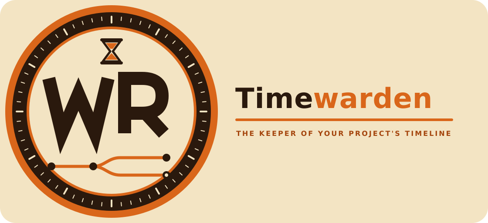

<p align="center"></p>

# Timewarden

*The guardian of your project's time:* it remembers what was decided, what was deployed, and which branch each thing ended up on.

**Persistent, verifiable, local memory for code agents (Claude Code), with OpenSpec directing every change.**

Timewarden turns a repository into a project that *remembers*: when a session opens, the agent already knows the goal, the current decisions, what is deployed and what isn't (per branch), which vulnerabilities are open, and where the last piece of work was left off. For anything not in that summary, it queries a semantic memory that runs **on your own machine** (Docker), at no cost per query.

> It installs itself: you hand the folder to an agent, it detects the project type (dbt, Dataform, Snowflake, BigQuery, web application…), **asks you about anything ambiguous**, and leaves everything ready. See [`seed-bundle/AGENT_PROMPT.md`](seed-bundle/AGENT_PROMPT.md).

## What you get

| Capability | What it does | Costs tokens |
|---|---|---|
| **Startup briefing** | A hook injects ~1,500 tokens: goal, decisions, rules, pending items, deployments, security, active OpenSpec changes, and the current branch's checkpoint | No (deterministic, no LLM) |
| **Semantic recall** | `project-memory-recall` skill + MCP: searches the memory by fragments, isolated per project | No (local embeddings) |
| **Per-branch checkpoint** | On close/compaction it saves the branch, HEAD, uncommitted changes, and the latest requests | No |
| **Deployment registry** | Which commit is in each environment, how many commits are missing, and whether the current branch is merged/deployed | No |
| **Versions and security** | Dependency inventory, history (`security` vs `upgrade`), vulnerability audit (OSV) launched automatically when a session opens, and visible pending items | No |
| **OpenSpec directs changes** | Mandatory rule: proposal → review → implementation → archive; specs are also indexed in the memory | Only when indexing |
| **Data profiles** | Specialized rules for dbt + Snowflake, Dataform + BigQuery, BigQuery/Terraform, web apps | No |
| **Management Memory dashboard** | Read-only board: health, vectors, graph, PostgreSQL, tokens/cost, memory usage | No |

Indexing new documents does consume your Claude subscription (≈ 2 calls per fragment); querying does not.

## Installation in 4 commands
```bash
cd Timewarden
seed-bundle/seed.sh doctor                                   # requisitos
seed-bundle/seed.sh machine --yes                            # una vez por equipo (Docker + observer)
seed-bundle/seed.sh project /path/to/repo my-project --lang auto --profile auto
seed-bundle/seed.sh panel --yes                              # panel en http://127.0.0.1:45876
```
`--lang auto` and `--profile auto` detect the language and project type; if they are unclear, they **exit with code 3 so the agent asks you**. Full guide: [`docs/INSTALL.md`](docs/INSTALL.md) (for the agent: [`seed-bundle/SEED.md`](seed-bundle/SEED.md)).

## Documentation
| Document | Contents |
|---|---|
| [`docs/INSTALL.md`](docs/INSTALL.md) | **How to install it** step by step (with an agent or by hand), exit codes, another machine, updating and uninstalling |
| [`docs/COMPONENTS.md`](docs/COMPONENTS.md) | **What each thing is for**: folders, scripts, skills, hooks, containers, and the files that get created |
| [`docs/HOW_IT_WORKS.md`](docs/HOW_IT_WORKS.md) | How it works, with graphs: installation, the lifecycle of a session, security audit, deployments, OpenSpec |
| [`docs/DEPENDENCIES.md`](docs/DEPENDENCIES.md) | Everything it depends on (images, versions, tools) and what leaves your machine |
| [`docs/DATA_PROJECTS.md`](docs/DATA_PROJECTS.md) | Data projects: BigQuery, Dataform, Snowflake, dbt |
| [`docs/OPENSPEC.md`](docs/OPENSPEC.md) | How OpenSpec directs the work and links to the memory |
| [`docs/SECURITY_AND_PRIVACY.md`](docs/SECURITY_AND_PRIVACY.md) | Privacy, secrets, network surface, and prohibitions |
| [`docs/architecture.md`](docs/architecture.md), [`docs/operations.md`](docs/operations.md), [`docs/continuity.md`](docs/continuity.md), [`docs/token-strategy.md`](docs/token-strategy.md), [`docs/diagrams.md`](docs/diagrams.md) | Detailed architecture, day-to-day operation, continuity between sessions, token strategy, diagrams |
| [`seed-bundle/spec/`](seed-bundle/spec/Cognee-memory-specification.md) | Full technical specification and troubleshooting table (§21.7) |

## Requirements
macOS with Docker Desktop (**the only validated platform**), Claude Code ≥ 2.1.287 with an active login, Python 3, git, [OpenSpec](https://github.com/Fission-AI/OpenSpec), and an internet connection during the first installation. Details and versions: [`docs/DEPENDENCIES.md`](docs/DEPENDENCIES.md).

## Development with OpenSpec
This repository is developed with its own method: the current specs are in [`openspec/specs/`](openspec/specs/) and every change goes through `openspec/changes/`.

## License
[MIT](LICENSE). Logo: hourglass and branching timeline with the WR monogram; inspired by the retro "time authority" aesthetic, without using any protected material.
