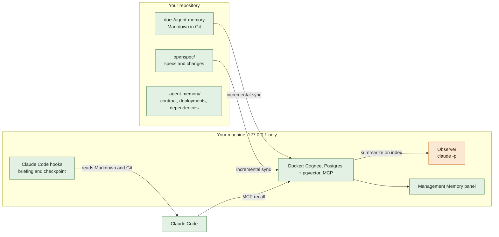
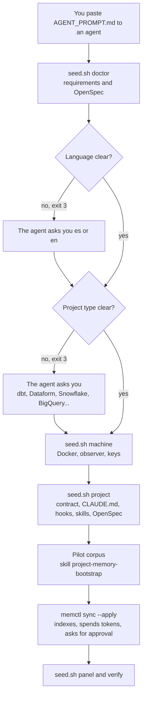
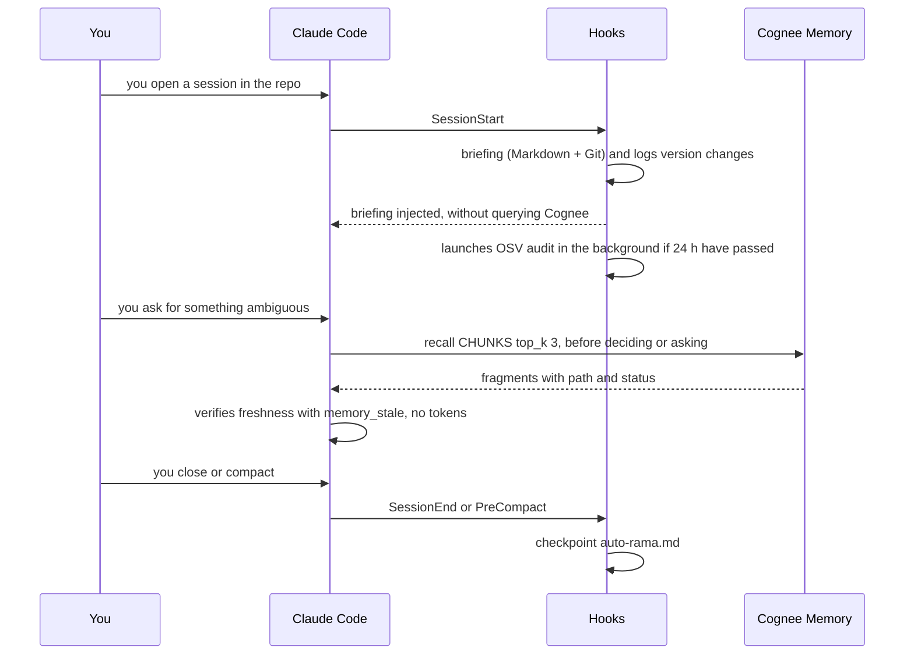
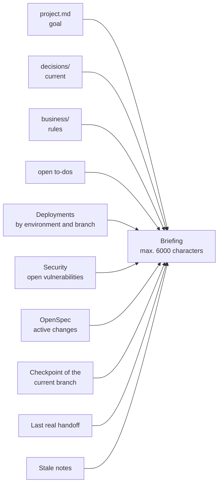
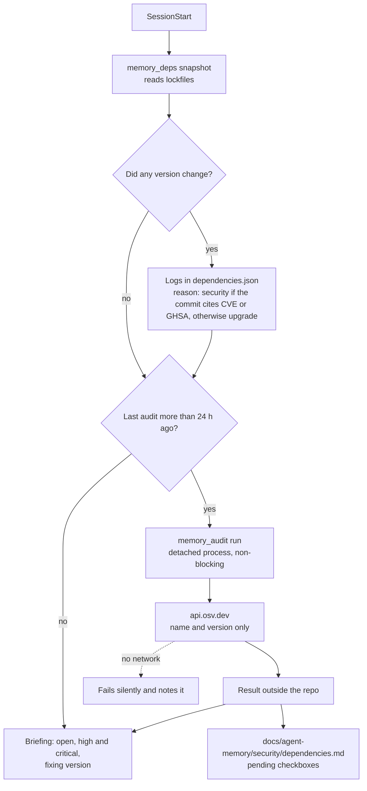
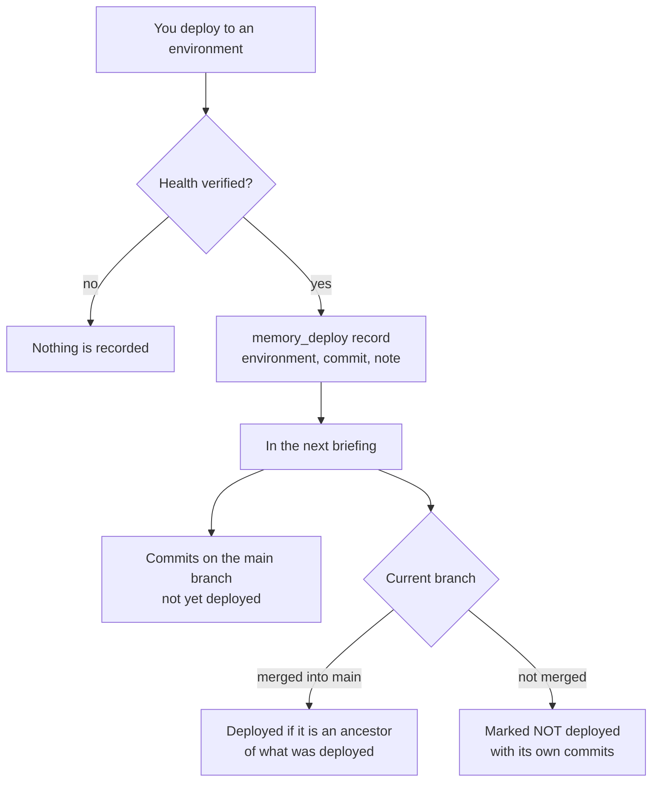
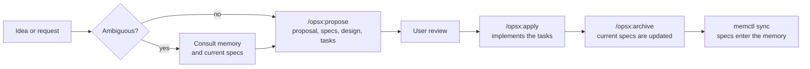
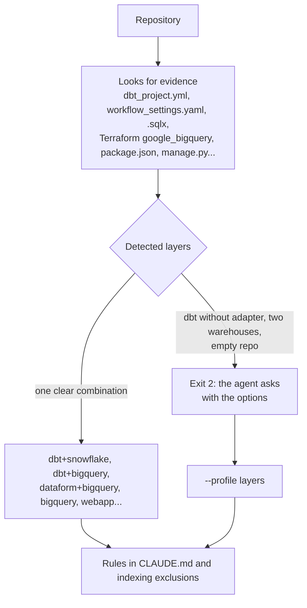

# How it works

The graphs are Mermaid: GitHub renders them directly. Colors: **green** = does not spend Claude tokens; **orange** = does.

## 1. Overview

**Principle:** the Markdown in Git is the source of truth; Cognee is a derived index (it can be rebuilt). Querying is free; indexing costs.

## 2. Agent-guided installation

## 3. Lifecycle of a session

## 4. What the briefing contains

The cap trims the body, never the footer with the usage instructions.

## 5. Automatic security audit

## 6. Deployments and branches

In data projects, "deployed" means the production job/release finished successfully on that commit.

## 7. OpenSpec drives the changes

Exceptions with no change: typos, formatting, comments, and urgent hotfix (documented afterward with a change).

## 8. Project type detection

For the detailed architecture diagrams (write, read, continuity, history) see [`diagrams.md`](diagrams.md).
