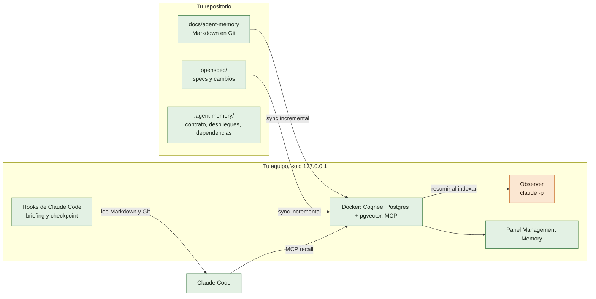
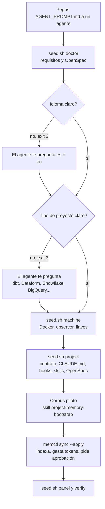
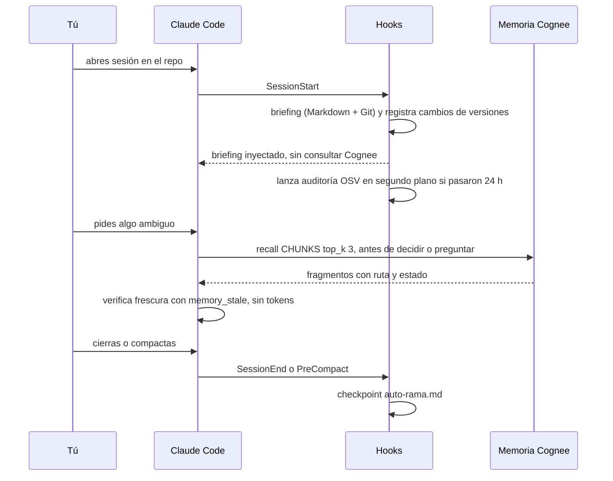
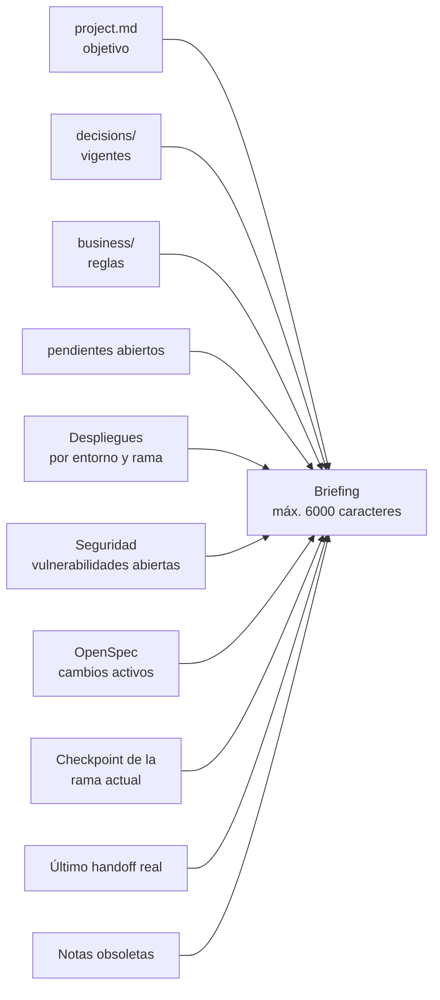
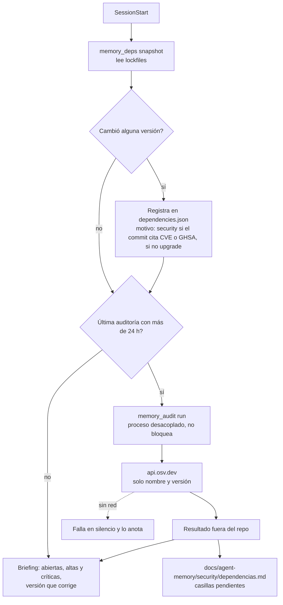
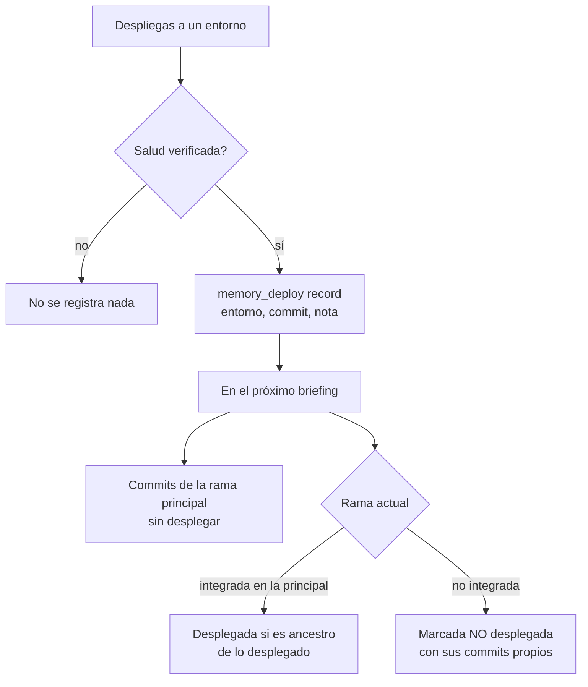
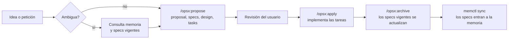
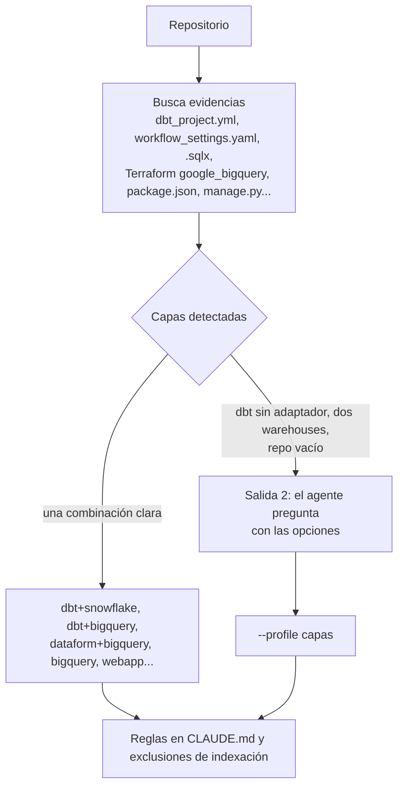

# Cómo funciona

Los grafos son Mermaid: GitHub los dibuja directamente. Colores: **verde** = no gasta tokens de Claude; **naranja** = sí.

## 1. Idea general

**Principio:** el Markdown en Git es la fuente de verdad; Cognee es un índice derivado (se puede reconstruir). Consultar es gratis; indexar cuesta.

## 2. Instalación guiada por un agente

## 3. Ciclo de una sesión

## 4. Qué lleva el briefing

El tope recorta el cuerpo, nunca el pie con las instrucciones de uso.

## 5. Auditoría de seguridad automática

## 6. Despliegues y ramas

En proyectos de datos «desplegado» significa que el job/release de producción terminó bien sobre ese commit.

## 7. OpenSpec dirige los cambios

Excepciones sin cambio: erratas, formato, comentarios y hotfix urgente (se documenta después con un cambio).

## 8. Detección del tipo de proyecto

Para los diagramas de arquitectura detallados (escritura, lectura, continuidad, historia) ver [`diagrams.md`](diagrams.md).
