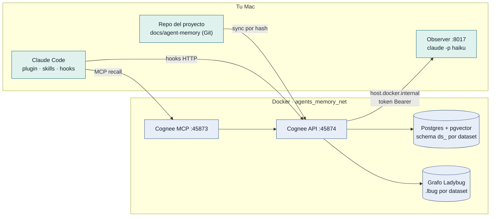
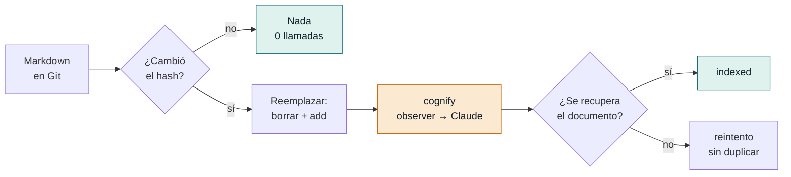
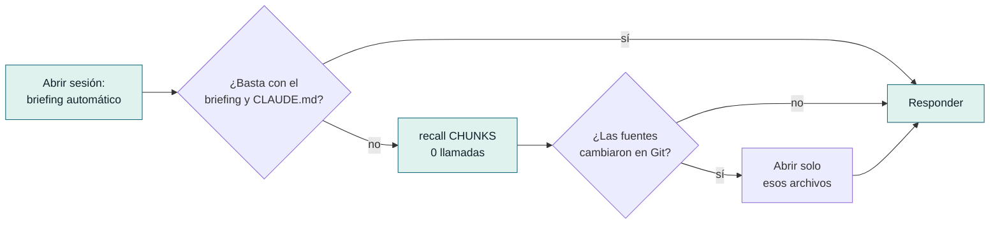
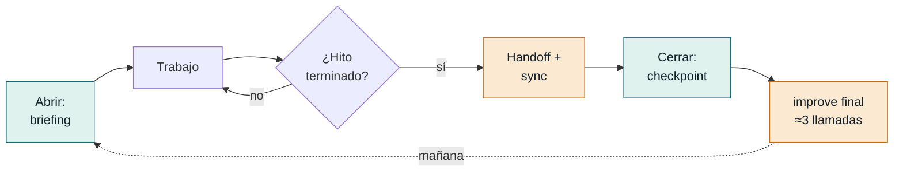
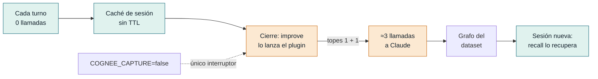

# Diagramas (Mermaid)

Fuentes en `docs/diagrams/*.mmd`; GitHub los dibuja aquí. Verde = no cuesta llamadas a Claude; naranja = sí cuesta. Para regenerar PNG: `npx @mermaid-js/mermaid-cli -i docs/diagrams/NN-x.mmd -o NN-x.png -c docs/diagrams/mermaid-config.json -w 2400 -s 2`.

## Arquitectura: quién llama a quién

## Flujo de escritura

## Flujo de lectura

## Ciclo de un día de trabajo

## Dónde se paga la historia de sesiones

