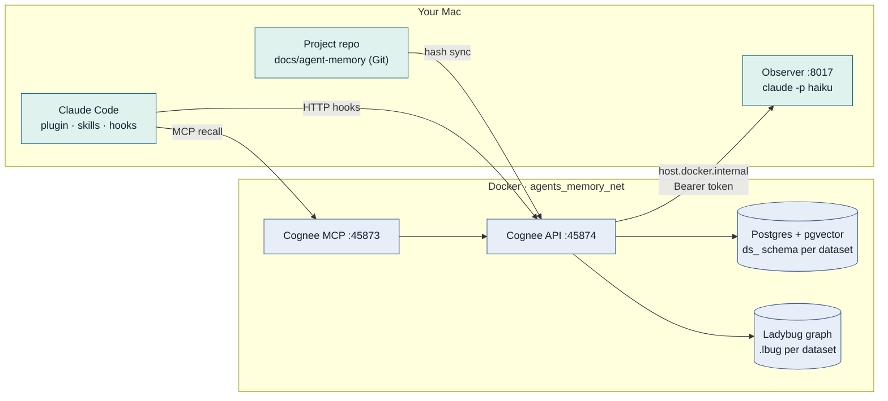
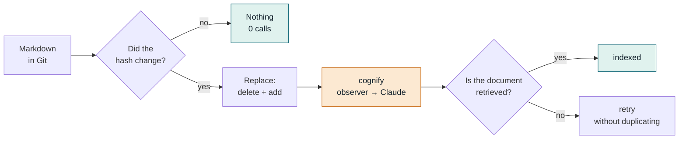
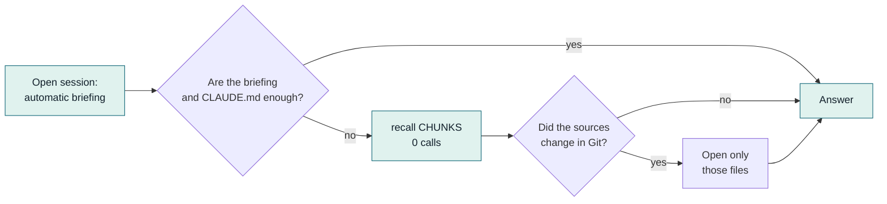
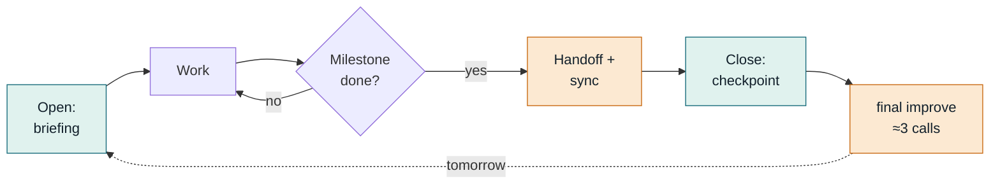
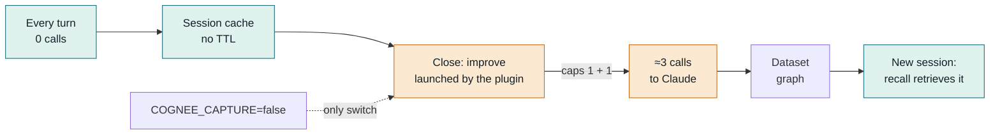

# Diagrams (Mermaid)

Sources in `docs/diagrams/*.mmd`; GitHub renders them here. Green = costs no calls to Claude; orange = does cost calls. To regenerate PNG: `npx @mermaid-js/mermaid-cli -i docs/diagrams/NN-x.mmd -o NN-x.png -c docs/diagrams/mermaid-config.json -w 2400 -s 2`.

## Architecture: who calls whom

## Write flow

## Read flow

## A working day cycle

## Where the session history is paid for

